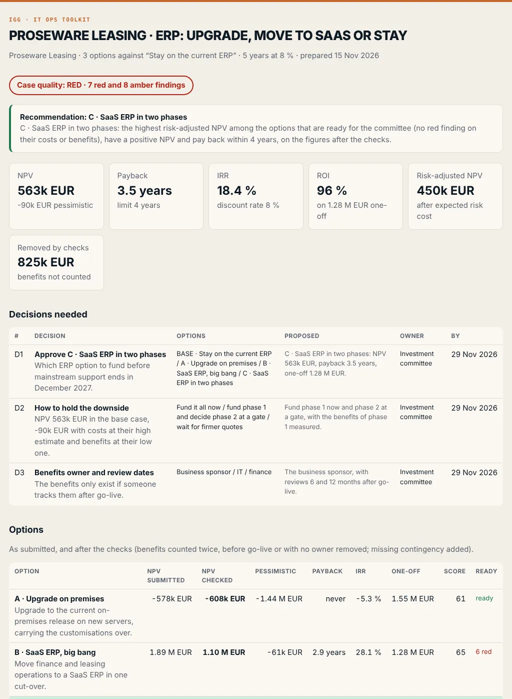

# IT Business Case Builder

The question before every IT investment committee: of the options on the table, which one should we fund, and do the numbers hold up? From the options, their costs year by year, the benefits, the risks, the assumptions and the non-financial criteria, it puts together:

- **The comparison with doing nothing:** every option against the cost of keeping today's platform for the whole horizon, with NPV, IRR, payback, ROI, the one-off cost, the total cost of ownership and the risk-adjusted NPV.
- **The checks a finance partner makes before the committee:** savings counted twice, benefits booked before go-live, hard benefits nobody owns, time saved counted as cash, benefits with no KPI, unvalidated assumptions that carry the case, missing cost lines (migration, decommission, training, our own people), years with no running cost, contingency below what the estimates need, and risks with no mitigation. The figures are shown **as submitted and after the checks**.
- **The ranges:** pessimistic and optimistic cases from the confidence of each cost and the evidence behind each benefit, and the sensitivity of the NPV to costs, benefits, a late go-live and the discount rate.
- **The recommendation and the decisions:** the option with the highest risk-adjusted NPV among those whose figures can be trusted, that make money and pay back in time; the decisions the committee has to take; and a benefits register with owner, KPI and review dates.

Python 3.10+, standard library only. It runs with fictional demo data out of the box, and `bizcase template` writes empty files to fill in from your spreadsheet.

It sits next to [49-it-project-portfolio-health](https://github.com/inigogonzalezgarcia/49-it-project-portfolio-health), which follows the approved projects and their benefits, and [50-saas-licence-spend-review](https://github.com/inigogonzalezgarcia/50-saas-licence-spend-review) and [23-it-vendor-contract-tracker](https://github.com/inigogonzalezgarcia/23-it-vendor-contract-tracker), where the running costs and the contracts come from.



## Why

Most IT business cases are decided on one number, and that number is often wrong in the same few ways:

- a saving that is already in the cost comparison is added again as a benefit;
- benefits start in year 1 when the new system goes live in month 15;
- "time saved" becomes cash although no budget goes down;
- the vendor's discount or the release of a contractor is assumed, not confirmed;
- the project has no line for migrating the data, retiring the old platform or training anyone;
- there is no contingency, or the same 5 % on everything whatever the quality of the estimate;
- the base case is shown alone, without what happens if costs go up a fifth or go-live slips six months.

The builder reads the case as a finance partner would, removes what should not be counted, and shows the committee the result with its range. The rules are in `settings.json` and `bizcase/checks.py`.

## What it checks

| Area | Code | Finding | Severity |
|---|---|---|---|
| Benefits | BEN-DOUBLE | A saving on a cost the baseline pays and the option no longer has: it is already in the cost difference (removed) | RED |
| Benefits | BEN-EARLY | Benefits booked before the go-live year (removed for those years) | RED |
| Benefits | BEN-NOOWNER | A hard benefit with no owner (moved to soft) | RED |
| Benefits | BEN-NOKPI, BEN-PRODUCTIVITY | No KPI, baseline or target; productivity counted as cash | AMBER |
| Assumptions | ASM-UNVALIDATED | An unvalidated assumption behind 20 % or more of an option's hard benefits; 40 % or more | AMBER; RED |
| Costs | COST-MISSING | No migration or decommission cost; no training or internal staff cost | RED; AMBER |
| Costs | COST-RUN | Years after go-live with no running cost | RED |
| Costs | COST-CONTINGENCY | Contingency below 5, 10 or 20 % of the one-off costs by confidence (the gap is added in year 0) | RED with none; AMBER |
| Risks | RISK-NOMITIGATION | A risk with no mitigation or owner | AMBER |
| Financials | FIN-PAYBACK | Never pays back; pays back after the limit | RED; AMBER |
| Financials | FIN-PESSIMISTIC | Negative NPV in the pessimistic case | AMBER |
| Criteria | CRIT-WEIGHTS | Weights that do not add up to 100 | AMBER |

An option with a red finding on its costs or benefits is **not ready** for the committee and is not recommended, whatever its NPV. [docs/data-format.md](docs/data-format.md) has every rule, column and setting.

## Outputs

| File | What |
|---|---|
| `report.html` | The recommendation, tiles (NPV and pessimistic NPV, payback, IRR, ROI, risk-adjusted NPV, benefits removed), the decisions, the options as submitted and after the checks, the cumulative cash flow, the sensitivity, the benefits register, the assumptions, the criteria and every finding |
| `business-case.md` | The paper for the committee: decision, recommendation, options, cash flow of the recommended option, sensitivity, benefits and owners, risks, decisions needed, checks, assumptions, method and notes |
| `options-summary.csv` | One row per option with every figure, its status and its findings |
| `cashflows.csv` | Year by year per option: cost of doing nothing, cost of the option, hard benefits, net, cumulative and discounted |
| `sensitivity.csv` | NPV of the recommended option per scenario and the change from the base case |
| `benefits-register.csv` | Every benefit with what is counted and why not, KPI, owner, evidence, assumptions and the review dates 6 and 12 months after go-live |
| `assumptions-review.csv` | Every assumption with its source, owner, whether it is validated and how much benefit hangs on it |
| `findings.csv`, `actions.csv` | Every finding with severity, option, owner and due date; the same as actions with a reference and a done column |

## Try it

```bash
git clone https://github.com/inigogonzalezgarcia/54-it-business-case-builder.git
cd 54-it-business-case-builder
python -m bizcase demo
```

Open `output/report.html` and `output/business-case.md`.

### The demo data

The demo is a made-up vehicle leasing company, Proseware Leasing, with a head office in Madrid and a branch in Lisbon. Mainstream support for its ERP ends in December 2027, and the committee meets on 29 November 2026 to choose, over 5 years at an 8 % discount rate, between:

- **BASE:** stay on the current ERP with extended support (the cost of doing nothing: 5.34 M EUR over 5 years);
- **A:** upgrade on premises on new servers, live in month 12;
- **B:** a SaaS ERP in one big-bang cut-over, live in month 15;
- **C:** a SaaS ERP in two phases, finance in month 9 and leasing operations in month 21.

Everything is fictional: the company, prices, quotes and people. The problems are placed on purpose, mostly in the option that looks best:

- **B as submitted** shows an NPV of 1.89 M EUR. It counts the end of the server maintenance contract again as a benefit (475k), books the faster month-end close in year 1 although go-live is in year 2, and has no owner for it; there is no migration or decommission line and no contingency; two unvalidated assumptions (the month-end close falling from 8 to 5 days, and the release of the BI contractor) carry more than half of its hard benefits; its subscription is priced on a 35 % discount that only an email mentions; and the big-bang cut-over risk has no mitigation.
- **A** never pays back: it renews the platform but keeps its costs.
- **C** is complete and cautious: soft benefits kept outside the NPV, contingency included, the main assumption validated with a signed quote.

The result: **RED** case quality with 7 red and 8 amber findings, and 825k EUR of benefits removed. B falls from 1.89 M to 1.10 M EUR after the checks and is not ready. **C is recommended:** NPV 563k EUR, IRR 18.4 %, payback 3.5 years, one-off cost 1.28 M EUR, risk-adjusted NPV 450k EUR, but -90k EUR in the pessimistic case. The decisions: approve C; fund phase 1 now and phase 2 at a gate once the benefits of phase 1 are measured; and the benefits owner with reviews 6 and 12 months after go-live.

## Use it with your own data

1. Write the empty files and fill them in from your spreadsheet (or export each tab as CSV with these column names):
   ```bash
   python -m bizcase template data/
   ```
   - `options.csv`: the options, with exactly one baseline (doing nothing) and the go-live month of each;
   - `costs.csv`: one row per cost item and year, with category, capex or opex, the confidence of the estimate and its basis (quote, contract, estimate);
   - `benefits.csv`: one row per benefit and year, hard or soft, with KPI, baseline, target, owner, evidence and the assumptions behind it;
   - `risks.csv`, `assumptions.csv`, `criteria.csv` (optional) and `settings.json`: discount rate, horizon, payback limit, contingency by confidence, owners ([docs/data-format.md](docs/data-format.md) has every column and setting).
2. Build the outputs:
   ```bash
   python -m bizcase build data/
   ```

[docs/business-case-runbook.md](docs/business-case-runbook.md) has the cycle from first draft to the committee, how to read the result (fix the reds, then validate the assumptions, then look at the range), how to present the recommendation and the downside, and what to do after the decision.

Business cases carry prices, quotes and salaries. Keep them inside your organisation:

- real files at the top level (`options*.csv`, `costs*.csv`, `benefits*.csv`, `risks*.csv`, `assumptions*.csv`, `criteria*.csv`, `settings.json`, `data/`) and the `output/` folder are excluded from Git by `.gitignore`;
- only the fictional files in `sample_data/` are committed.

## Tests

```bash
pip install -r requirements-dev.txt
python -m pytest -q
```

GitHub Actions runs them on Python 3.10 and 3.12 on every push, checks that the committed sample data is what the simulator writes, and keeps the demo report and a screenshot as build artifacts.

16 tests: the parsers (amounts in both number formats, probabilities, cost categories); NPV, IRR and payback; a clean case with no red finding and its cash flow; each check (double counting, benefits before go-live, benefits with no owner, productivity and KPIs, unvalidated assumptions, missing costs and the contingency gap, years with no running cost, an option that never pays back); the sensitivity and the decisions; loading errors; the demo end to end with every output; the template; and the command line.

## Next steps

- Keep `benefits-register.csv` after the decision and compare it with actuals at 6 and 12 months, as in repo 49.
- Read the running costs straight from the licence and contract registers of repos 50 and 23.
- Add a Monte Carlo range next to the pessimistic and optimistic cases.
- Add the cost of capital and the depreciation of capex for organisations that report on an accounting basis.

## Background

Built from my work managing IT budgets and preparing investment cases:

- business cases with ROI and measurable benefits for infrastructure and service projects;
- estimating costs, resources and timelines, and managing the IT budget;
- FinOps and technology business management (TBM, Apptio) for cost transparency;
- negotiating vendor contracts and renewals;
- running ERP support (SAP) for the business.

Written from scratch with fictional data; no employer data, figures or documents are used.

## Customisation and contact

Want this adapted to your organisation? For example:

- your discount rate, horizon, payback limit and contingency rules;
- your cost categories and your committee's template;
- your sources: the budget, the contract register, the PPM tool;
- the paper in your investment committee's format.

Get in touch:

- Website (contact form): [inigogonzalezgarcia.github.io](https://inigogonzalezgarcia.github.io/about.html#contacto)
- LinkedIn: [linkedin.com/in/igonzalez93](https://www.linkedin.com/in/igonzalez93)

## License

MIT
